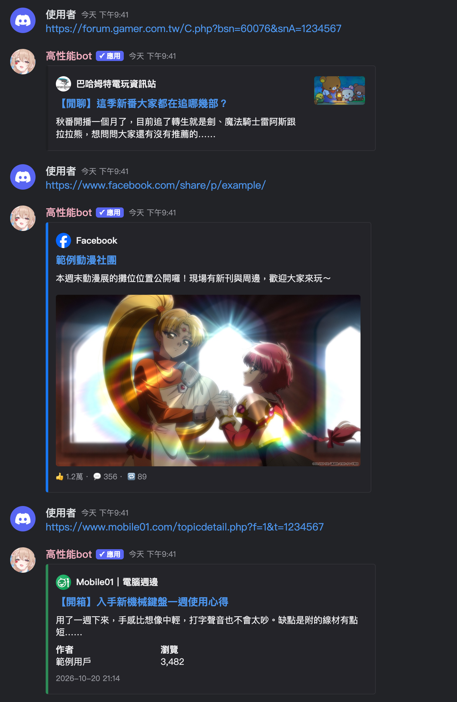
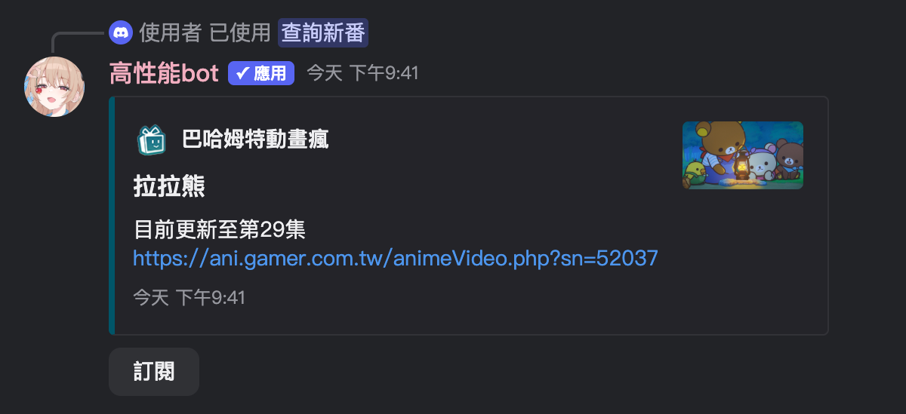
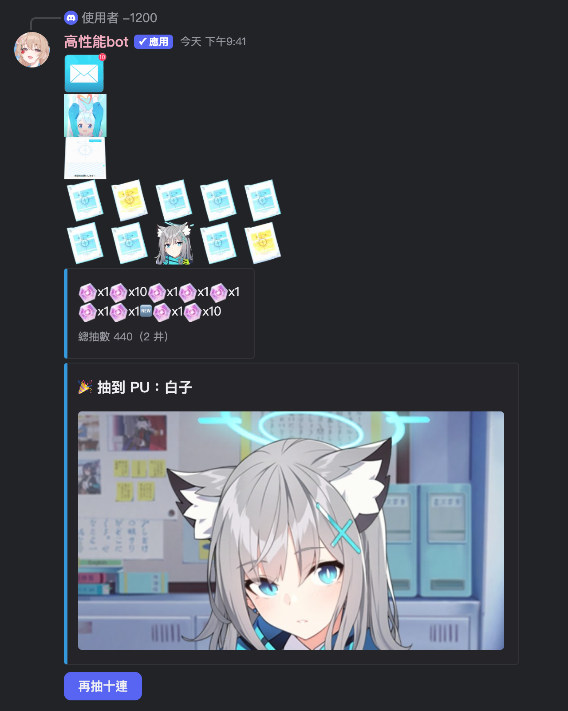

# 高性能bot (Kouseinou Bot)

A Discord bot inspired by [ermiana](https://github.com/canaria3406/ermiana), with richer link previews, anime update notifications from [動畫瘋](https://ani.gamer.com.tw), and a Blue Archive gacha simulator.

- [Add the bot](https://discord.com/discovery/applications/1243841697637601310)
- [Support server](https://discord.gg/ERSk9sYWyP) — questions, suggestions, and bug reports
- [Terms of service](docs/Terms_of_service.md) · [繁體中文服務條款](docs/Terms_of_service_zh_TW.md) · [Privacy policy](docs/Privacy_policy.md)

## Link previews

Paste a link in chat and the bot replies with a rich preview. Supported sites: Bahamut's 場外 board, Facebook, Mobile01, nhentai, wnacg, 禁漫天堂 (18comic), E-Hentai / ExHentai, hitomi, kemono / coomer, MissAV, Jable, Supjav, Hanime1, Iwara, XVideos, and Pornhub.

- Facebook previews show the post text, up to four photos, reactions, and video links.
- Mobile01 previews show the board, author, view count, and attached photos.
- Server managers can turn previews for individual sites on or off with `/解析網頁開關`.

### Gallery reader

Gallery previews (nhentai, wnacg, 禁漫天堂, E-Hentai / ExHentai, hitomi, and multi-image kemono / coomer posts) show the author, tags, and page count, with first / previous / next / last page buttons right in the message. Right-click the message → **Apps → 跳轉頁數** to jump straight to any page.

### Bookmarks

Right-click a preview → **Apps → 加入書籤** and the bot DMs you the page you're on, with working page buttons. Keep reading in the DM and the bookmark follows your latest page; bookmarking the same gallery again replaces the old one.

- `/書籤 列表` lists your bookmarks, optionally filtered by site, each with its own delete button.
- `/書籤 新增` adds a bookmark from a message link.

### Lookup commands

| Command | Purpose |
| --- | --- |
| `/nhentai` | Look up a gallery by ID. |
| `/wnacg` | Look up an album by ID. |
| `/jm` | Look up a 禁漫天堂 album by ID. |
| `/ehentai` | Look up an E-Hentai / ExHentai gallery by number, link, or `gid token`. |
| `/av番號查詢` | Search by video code across MissAV, Jable, and Supjav. |
| `/missav` | Look up a video on MissAV. |
| `/jable` | Look up a video on Jable. |
| `/supjav` | Search Supjav by video code. |

## Anime update notifications

Subscribe to shows on 動畫瘋 and the bot posts in your server as soon as a new episode is up.

| Command | Purpose |
| --- | --- |
| `/新番列表` | Show this season's airing anime. |
| `/查詢新番` | Search for an anime and subscribe with one click. |
| `/訂閱` | Subscribe to an anime. |
| `/訂閱列表` | Show the server's subscriptions. |
| `/刪除訂閱` | Remove a subscription. |
| `/設定頻道` | Send notifications to the current channel. |

## Blue Archive gacha simulator

Send `-1200` for a ten-pull, played out in a single message: envelope, Arona, result sheet, then the cards. Press **再抽十連** to pull again. Pulling the rate-up student shows their memorial lobby art.

The rate-up banner follows the Global server automatically, and the pity system follows the official recruitment rules.

- `/統計` shows your pull statistics; `/歸零` resets them.
- `/換池` picks which rate-up student is active.
- `/上鎖` and `/解鎖` let admins turn the simulator off or on in a channel.

## Earthquake alerts

Working with 地牛 Wake UP!, the bot posts an alert with the expected intensity and arrival time before shaking reaches you. The collaboration directory is set in 地牛 Wake UP! under `setting > others`.

## Other

- `/歡迎訊息` sets a message the bot posts when someone joins, in the channel where you run it.
- `/help` lists the available commands.
- Right-click one of the bot's messages → **Apps → 刪除訊息** to delete it.

## Contributing

Report problems or suggest features in the [support server](https://discord.gg/ERSk9sYWyP) or the repository's issues.
