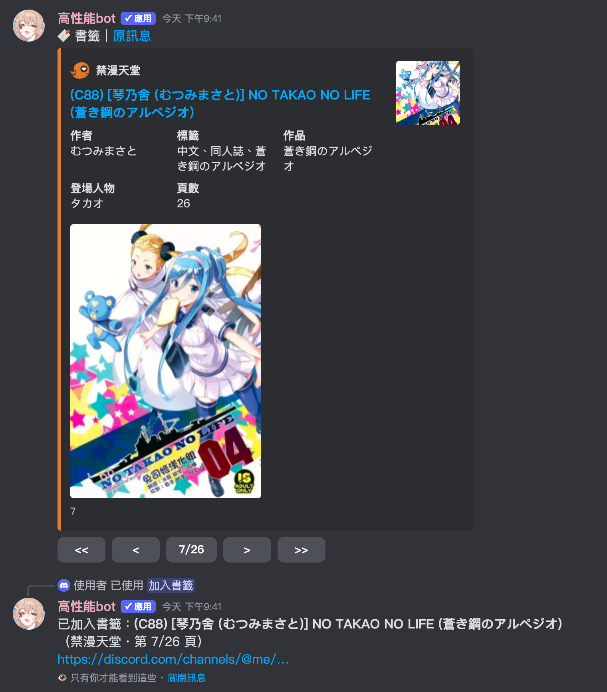
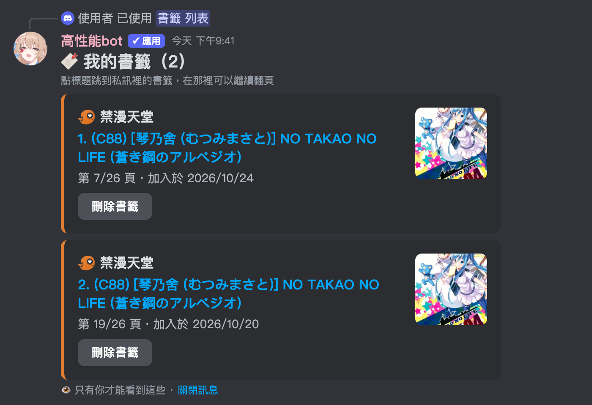
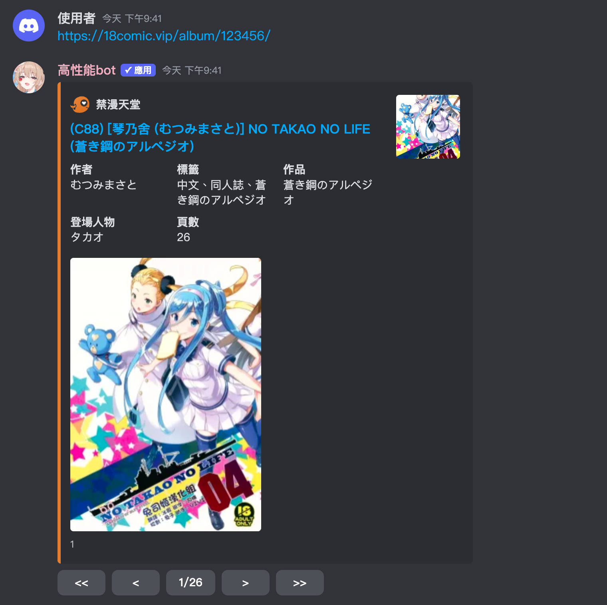
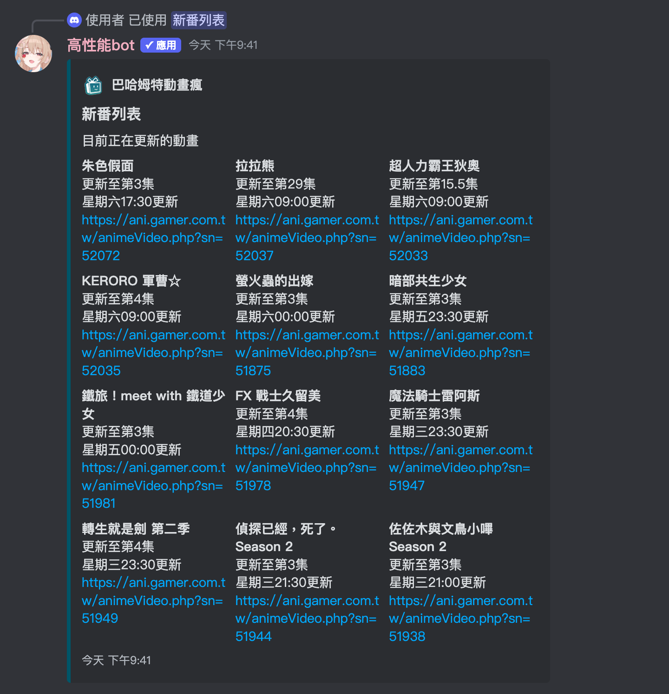
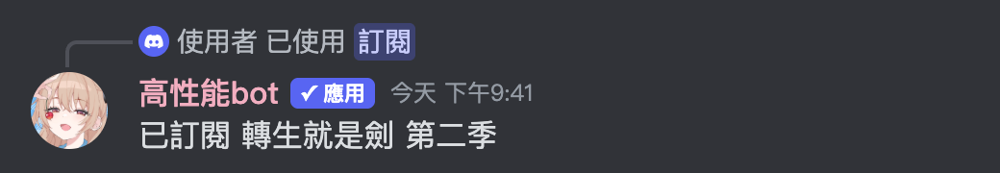
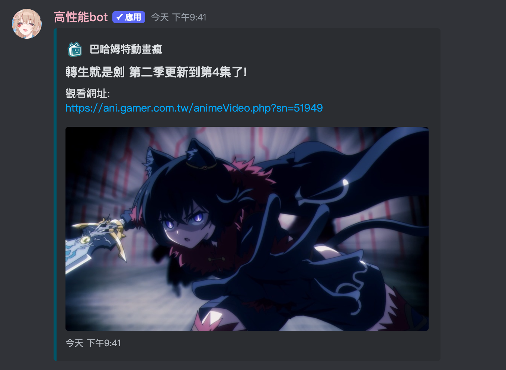
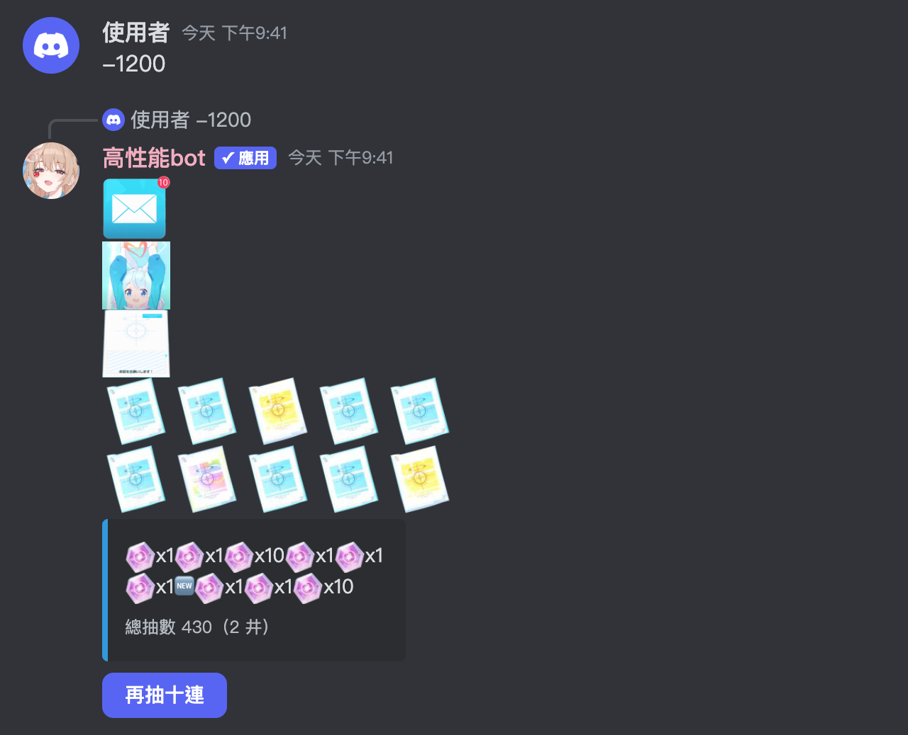
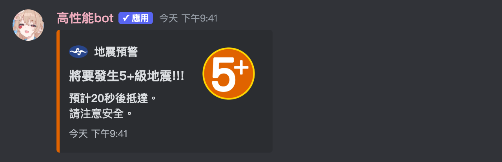

# 高性能bot (Kouseinou Bot)

[](https://discord.com/discovery/applications/1243841697637601310)
[](https://discord.com/discovery/applications/1243841697637601310)
[](https://discord.gg/ERSk9sYWyP)


A Discord bot inspired by [ermiana](https://github.com/canaria3406/ermiana), with richer link previews, anime update notifications from [動畫瘋](https://ani.gamer.com.tw), and a Blue Archive gacha simulator.

- [Add the bot](https://discord.com/discovery/applications/1243841697637601310)
- [Support server](https://discord.gg/ERSk9sYWyP) — questions, suggestions, and bug reports
- [Terms of service](docs/Terms_of_service.md) · [繁體中文服務條款](docs/Terms_of_service_zh_TW.md) · [Privacy policy](docs/Privacy_policy.md)

## Features and commands

### Link previews and lookup

The bot recognizes links for nhentai, wnacg, 禁漫天堂 (18comic), E-Hentai / ExHentai, hitomi, kemono / coomer, MissAV, Jable, Supjav, Hanime1, Iwara (videos and image posts), XVideos, Pornhub, Facebook, Mobile01, and Bahamut's 場外 board. Supported URL formats vary by site, and previews depend on the source website being accessible.

ExHentai links work without an account: gallery info comes from the E-Hentai API and pages are read from e-hentai.org. Galleries that exist only on ExHentai need `exhentai_cookies` (`ipb_member_id`, `ipb_pass_hash`, `igneous`) in `data/token.json` (the owner can also paste the browser's Cookie string into the hidden `/excookies` command, which checks the login before saving); without them those previews show the cover only.

Facebook previews support post text and up to four attached photos. Video links are included when available. Facebook cookies are optional; without a usable cookies file, the scraper uses anonymous access.

| Command | Purpose |
| --- | --- |
| `/nhentai` | Look up a gallery by ID. |
| `/wnacg` | Look up an album by ID. |
| `/jm` | Look up a 禁漫天堂 album by ID. |
| `/ehentai` | Look up an E-Hentai / ExHentai gallery by number, link (gallery or single-page), or `gid token`. A number alone can't find deleted galleries. NSFW channels only. |
| `/av番號查詢` | Search by video code, preferring MissAV, then Jable, then Supjav. |
| `/missav` | Look up a video on MissAV only. |
| `/jable` | Look up a video on Jable only. |
| `/supjav` | Search Supjav by video code. |
| `/解析網頁開關` | Configure the available website preview switches. See the limitation below. |

Gallery messages (nhentai, wnacg, 禁漫天堂, E-Hentai / ExHentai, hitomi, and multi-image kemono / coomer posts) have first/previous/next/last-page buttons. Use the message context menu **Apps → 跳轉頁數** to jump to a specific page. On wnacg previews, the middle refresh button fetches a fresh image URL when an old link expires; single-page wnacg links also resolve to their album and page.

**Bookmarks:** right-click a gallery preview → **Apps → 加入書籤** and the bot DMs you that page with working page buttons; keep reading in the DM and the bookmark stays on your latest page. Bookmarking the same gallery again replaces the old one. `/書籤 列表` lists your bookmarks (optionally filtered by site), `/書籤 新增` adds one from a message link, and each bookmark in the list has its own delete button. Bookmarks are only the bot's messages in your DMs; nothing is stored on the bot's host, and you need to allow DMs from server members.





Failed video lookups return a result or error message; there is no persistent background retry queue.

**Current limitations:**

- Automatic link detection needs Message Content Intent. Direct slash-command lookups provide a separate way to request previews.
- Automatic previews for wnacg (including single-page links), nhentai, E-Hentai / ExHentai, hitomi, kemono / coomer, Hanime1, Iwara, XVideos, and Pornhub require an age-restricted server channel. Threads use the parent channel's setting. This check does not block DMs, and it is not applied to 禁漫天堂, MissAV, Jable, or Supjav links. Among slash commands, only `/ehentai` checks for an age-restricted channel (it also works in DMs).
- `/解析網頁開關` saves per server. MissAV, Jable, Supjav, and Pornhub previews do not have a switch yet.



### Anime update notifications

Subscriptions and the notification channel are configured per server.

| Command | Purpose |
| --- | --- |
| `/新番列表` | Show the current anime list. |
| `/查詢新番` | Search for an anime and subscribe through its result. |
| `/訂閱` | Subscribe to an anime. |
| `/訂閱列表` | Show the server's subscriptions. |
| `/刪除訂閱` | Remove a subscription. |
| `/設定頻道` | Send future update notifications to the channel where you run this command. |

The bot checks subscribed shows around their scheduled update times and posts new-episode notifications. This feature does not require Server Members Intent.







### Gacha simulator

Send `-1200` to simulate a ten-pull, or press **再抽十連** on a result to pull again. Each ten-pull plays in a single message. Until the Global server's recruitment update (scheduled after the 2026-11-10 maintenance; the bot switches at 12:00 UTC+8 that day) pulls use the old rules with no pity, and `/統計` counts sparks (井) per 200 pulls. After that the bot uses the Japanese server's Recruitment Charge rules (from 2026-07-29), which Global's announced details may still change: every pull adds 1 to your charge, pull 100 is a guaranteed 3★ with a 50% chance of the rate-up student, pull 200 is a guaranteed rate-up, and the charge resets only when you get the rate-up student. This message trigger requires Message Content Intent in ordinary server messages.

The rate-up banner follows the Blue Archive Global server automatically: the bot checks [SchaleDB](https://schaledb.com)'s current Global banner every hour and rewrites `pu.json` when it changes (`/換池` lets you pick which rate-up student is active). Gacha icons and student portraits are uploaded as the bot's own application emojis, so they display in any server.

- `/統計` shows your results; `/歸零` resets your statistics.
- `/上鎖` and `/解鎖` control whether the simulator can be used in a channel, subject to the commands' permission checks.




### Welcome messages

`/歡迎訊息` saves a welcome message and uses the channel where the command was run. Sending it when someone joins requires **Server Members Intent**; saving the setting alone does not enable the intent. If the deployment lacks that access, join-triggered welcome messages are unavailable.

The current code also attempts a welcome DM when a server has no welcome-channel configuration. Automatic assignment of the `新人` role is hardcoded to one server; it is not a configurable public feature.

### Help

`/help` lists selected command groups. The command tables above also cover lookup commands that are not currently included in that help response.

## Discord intents

Server channel permissions and Gateway intents are separate requirements.

| Intent | Used for | Current code setting |
| --- | --- | --- |
| `GUILDS` | Server, channel, and role information/events. This is a standard intent. | Enabled |
| `GUILD_MESSAGES` / `DIRECT_MESSAGES` | Receiving message events. | Enabled via `intents.messages` |
| `MESSAGE_CONTENT` | Reading ordinary server messages for automatic previews, `-1200`, and `$` prefix commands. | Enabled |
| `GUILD_MEMBERS` (Server Members Intent) | Member-join events for welcome messages and the server-specific automatic role. | Enabled |
| `GUILD_PRESENCES` | Member online/activity updates; not needed by the current features. | Disabled |

The code settings in `bot.py` do not establish that a deployed app has been granted access. Request only intents enabled and permitted for your app in the Developer Portal. Requesting an unavailable privileged intent can prevent the bot from connecting (`4014` / `DisallowedIntents`). If Server Members Intent is unavailable, disable `intents.members` in your deployment and leave join-triggered features unavailable; slash commands and anime notifications do not require it.

Discord changed privileged-intent review on June 10, 2026: review is based on the app's reach across unique users, with a 10,000-user threshold, and approved access requires annual reapplication. Consult the Developer Portal and the [current review guide](https://docs.discord.com/developers/gateway/getting-started-with-privileged-intent-review), rather than the old 75/100-server guidance.

See also [Gateway intents](https://docs.discord.com/developers/events/gateway#gateway-intents) and [alternatives to privileged intents](https://docs.discord.com/developers/gateway/you-might-not-need-a-privileged-intent).

## Self-hosting

Self-hosting currently requires manual setup. This repository does not yet include a pinned dependency file or a complete first-run data initializer.

### Runtime and services

- Python and the packages imported by the enabled modules. The current bot and loaded cogs use `discord.py`, `aiohttp`, `requests`, `beautifulsoup4`, `lxml`, `curl_cffi`, `DrissionPage`, `requests-html`, `pandas`, and `pytz`. Resolve compatible versions in an isolated environment; this is an import inventory, not a tested dependency lockfile.
- A local FlareSolverr service at `http://localhost:8191/v1` for scraper fallback paths that need it.
- A Chromium/Chrome installation configured for DrissionPage's Supjav scraper.
- Any image proxy services referenced by your configuration. Some scraper URLs are still hardcoded; changing only `token.json` does not replace every external service URL.

### Configuration and data

From the repository directory, create your local settings **only if they do not already exist**:

```sh
cp -n data/token.json.example data/token.json
cp -n data/cookies.json.example data/cookies.json
```

Edit `data/token.json` before starting:

- Set the bot token and owner ID, and replace the other placeholders used by your deployment.
- Set unused `sheet_user_columns_check` and `sheet_user_columns_pay` mappings to `{}`, or replace their placeholder keys with numeric Discord IDs. `config.py` converts these keys to integers during import.
- Configure Bahamut credentials if using authenticated Bahamut features. The current startup path attempts a Bahamut login.
- Set proxy URLs to services you operate or have configured for this deployment.

The optional `data/fbcookies.json` accepts a Cookie Editor-style JSON list of objects containing `name` and `value`. Missing or invalid cookies fall back to anonymous Facebook access. Credentials and cookies must stay out of version control.

Several features read runtime JSON files directly and do not create them automatically. Prepare their data before enabling the relevant feature:

| Data files under `data/` | Purpose / initial structure |
| --- | --- |
| `block.json`, `lock.json` | Channel ID lists; start with `[]`. |
| `embed_permission.json`, `welcome.json` | Preview and welcome settings; start with `{}`. |
| `channel.json`, `sub.json` | Anime notification channels and subscriptions; start with `{}`. |
| `gacha.json` | Gacha statistics; start with `{}`. |
| `pu.json` | Current rate-up students; start with `{}` and the hourly Global banner sync fills it. |
| `test.json`, `alert.json` | Earthquake input and destination channels; see the integration limitation below. |

Do not overwrite existing runtime data. Check other feature-specific files when enabling additional commands. `bot.py` automatically loads every Python module in `cmds/`, including background tasks; move unused cogs out of that directory if their setup is incomplete.

### Start and verify

After preparing dependencies, local data, Discord intents, and channel permissions:

```sh
python3 bot.py
```

Check startup output for failed extensions and background-task errors. For a basic smoke test, use `/help`, a direct lookup, and an anime subscription. Test member-join behavior only when Server Members Intent is available. Link previews need permission to view and send messages and embed links; suppressing another user's original embed also requires the relevant message-management permission.

For macOS background execution, adapt [com.user.dcbot.plist.example](com.user.dcbot.plist.example) to your Python path and project directory. The bot reads credentials from `data/token.json`.

The offline regression tests can be run without starting the bot or making live scraper requests:

```sh
python3 -m unittest discover -s tests -v
```

### Earthquake integration: incomplete

The optional 地牛 Wake UP! integration is not available in the public bot and is not currently ready to deploy by following the old instructions alone.

- `main.cpp` writes to `json/earthquake.json` relative to its working directory.
- `cmds/EarthQuakeWake.py` reads and resets `data/test.json` and reads destination channel IDs from `data/alert.json`.

Before enabling it, make the producer and consumer use the same file, configure the executable's working directory, prepare destination channels, and verify the complete notification flow. Compiling `main.cpp` alone does not resolve this mismatch.

In 地牛 Wake UP!, the collaboration directory is set under `setting > others`:




## Contributing

Report problems or suggest features in the [support server](https://discord.gg/ERSk9sYWyP) or the repository's issues. Include the command or URL format, the observed behavior, and relevant errors with credentials and personal data removed.
